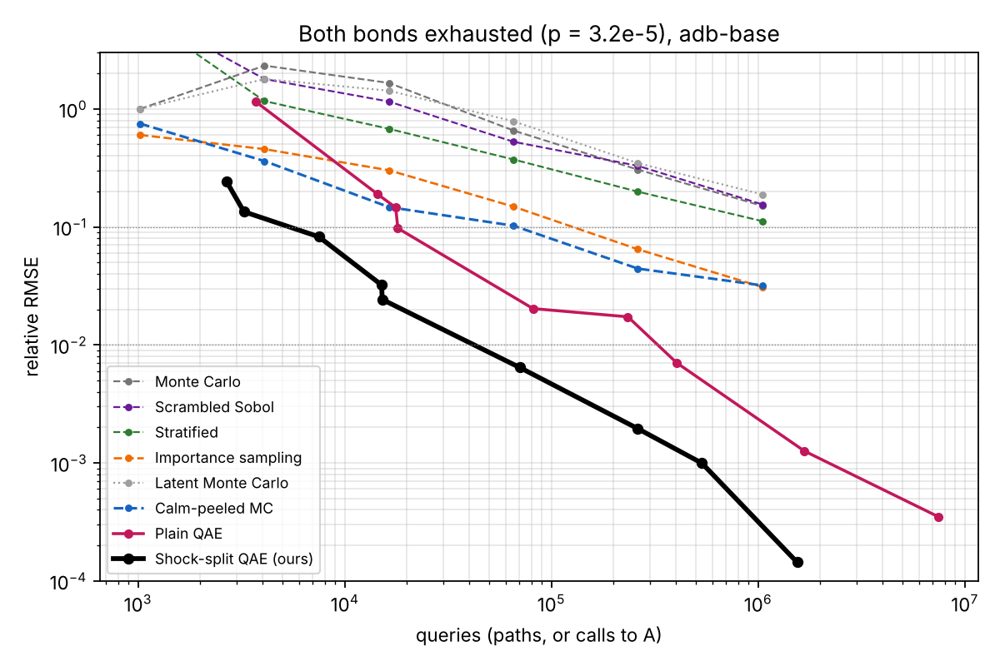

# Shock-split quantum amplitude estimation for joint disaster losses

ADB Quantum Challenge: Joint-Loss Modelling for Disaster Risk Financing.
Phase 1 prototype.

## The short version

All of the dependence between countries in the ADB model comes from a few shared shocks.
If we know which shared shocks fired during the term, the countries are independent.

So we split the problem in two:

- **Calm part.** No shared shock fired (97.6% of terms in the base case). Countries are
  independent, so a classical computer gets the exact answer cheaply.
- **Shock part.** At least one shared shock fired. This is where the rare joint tail
  lives, and this is the only part we send to the quantum computer. Inside it, the
  rare event is no longer rare. "Both bonds exhausted" has a probability of 3.2e-5
  overall, but 0.10 once two or more shocks have fired. Amplitude estimation is much
  cheaper on large amplitudes, which is where the gain comes from.

On the ADB benchmark, our method reaches 10% relative error on "both bonds exhausted"
with about 5,400 queries. The best challenge baseline (importance sampling) needs
about 127,000, and the textbook quantum approach (plain QAE) about 18,000. At 1% error
we need about 42,000 queries. Our best classical sampler would need about 6.8 million
there (extrapolated at its 1/error-squared rate), so roughly 160 times more.

## What we noticed in the model

**1. The three years collapse into one.** Payouts only go up. Capping each year at the
sub-limit and then capping the running total gives the same result as capping the
3-year total once. So the term is just the same compound Poisson model with three
times the rates. The year-by-year convolution in the challenge text is not needed. Our
code checks this against the challenge's own method, and they agree to about 1e-13.

**2. Shared shocks are the only link between countries.** A shared quake hits both
countries at the same time, but its size is drawn separately in each one. Once we fix
the number of shared quakes and whether the shared rain event happened, the two
countries are independent. Shared quake counts can stop at "4 or more" with no error,
because each one adds at least a quarter step and the cover stops at four.

**3. The joint tail sits in the shock strata.** Base case, "both bonds exhausted":

| Stratum | Probability of stratum | P(both exhausted given stratum) | Share of the answer |
|---|---|---|---|
| no shared shock | 0.9762 | 0.0000019 | 6% |
| 1 shared shock | 0.0236 | 0.00069 | 51% |
| 2 or more | 0.00013 | 0.102 | 43% |

The first row is computed exactly by classical code. Only the last two rows need
quantum estimation, and their conditional values are 20 to 3,000 times larger than
the overall answer.

## The method, step by step

1. **Exact calm stratum (classical).** Convolve the countries one by one on an integer
   loss grid. The cost is linear in the number of countries, whatever the shock layout.
2. **Stratum loaders (quantum).** For each shock stratum we build a circuit that
   prepares the shock registers restricted to that stratum. It then prepares each
   country with gates controlled only by the shocks that country belongs to. The
   loader grows linearly with countries and shocks. No 10^n table is ever loaded.
3. **Objective.** The payout logic (loss sum, threshold, "both exhausted" flag) is
   computed into one objective qubit.
4. **Iterative amplitude estimation per stratum.** We use IQAE (Grinko et al. 2021),
   stopping on the width of the amplitude interval rather than the angle interval.
   Qiskit's default angle rule is far too strict for small amplitudes.
5. **Budget split.** A cheap pilot run per stratum tells us how hard each stratum is.
   The accuracy budget is then split across strata, the same way a survey splits its
   sample across groups (Neyman allocation).
6. **Combine.** answer = calm part + sum of (stratum probability x stratum estimate).
   The stratum probabilities are known exactly, so they add no error.

## How this differs from the usual approach

The usual pipeline loads the full joint distribution into a register and runs amplitude
estimation on one small amplitude. That has three problems: the loader is exponential
in countries, the amplitude is tiny, and the circuits get deep. We avoid all three. We
use structure the model already has, let classical code do the part it does exactly,
and only send the hard, coupled part to the quantum computer.

We also built a strong classical method from the same idea ("Calm-peeled MC") and
benchmark against it. Beating the challenge baselines alone would not be an honest
test.

## Results on the ADB benchmark

Five scenarios, five targets, 20 independent repeats per point. One query is one path
for a sampler and one call to A or its inverse for QAE. Full tables are in
`results/summary.txt`, plots in `results/`.

Queries needed for "both bonds exhausted", base case:

| Method | 10% relative error | 1% relative error |
|---|---|---|
| Monte Carlo | > 1,000,000 | > 1,000,000 |
| Scrambled Sobol | > 1,000,000 | > 1,000,000 |
| Stratified (first payout year) | > 1,000,000 | > 1,000,000 |
| Importance sampling | 126,665 | > 1,000,000 |
| Calm-peeled MC (our classical) | 68,116 | > 1,000,000 |
| Plain QAE | 18,052 | 326,912 |
| **Shock-split QAE (ours)** | **5,397** | **42,257** |



The same pattern holds in the common-shock, rain-stress and rain-cover scenarios. In the
independent scenario there are no shared shocks, so our method is exact with no
quantum queries at all.

The circuit is real, not just a formula. For the 2-country case we built the full
13-qubit loader in Qiskit. Its amplitudes match the exact values to 1e-11 for all five
targets, and they still match after Grover powers 1 and 2. An IQAE run on that circuit
gave 0.1025 for a true value of 0.1017, with the truth inside its 95% interval (see
`results/circuit_check.txt`). The benchmark itself uses a noise-free oracle with the
same amplitudes, because simulating 20 repeats x 9 settings x 5 scenarios at circuit
level would take days on a laptop.

## Where classical methods stop

Our exact classical solver sweeps through the countries and only keeps the shocks that
are still "open". It is very fast when shocks link nearby countries:

| Countries (chain + regional shock) | Exact time | P(at least 2 exhausted) | Logical qubits per stratum circuit |
|---|---|---|---|
| 2 | 0.00 s | 3.2e-5 | 32 |
| 10 | 0.7 s | 4.7e-4 | 101 |
| 40 | 12 s | 4.2e-3 | 343 |

Its cost blows up with the number of shocks open at once (the "width"). With 12
countries where each country shares quake shocks with more neighbours:

| Neighbours sharing shocks | Width | Memory for exact sweep | Logical qubits |
|---|---|---|---|
| 1 | 4 | 0.02 GB | 114 |
| 2 | 7 | 2 GB (25 s) | 144 |
| 3 | 11 | 1,300 GB | 171 |
| 6 | 28 | 1e15 GB | 234 |

The quantum circuit grows by a few qubits per shock. Real seismic sources (fault
segments that affect many zones in several countries) look like the bottom rows, not
the top ones. That is the regime where we argue for quantum. Samplers still work
there, but they hit the slow 1/(error squared) rate on rare joint events.

## Hardware ask

**Phase 1 (done).** Everything here runs on a laptop in about 15 minutes.

**Phase 2, GPU (what we ask QAI Ventures for).**

- *Full arithmetic circuit, 2 countries.* 32 logical qubits means about 34 GB of state
  in single precision, which fits on one 80 GB data-centre GPU (A100 or H100 class).
  We would use a GPU state-vector simulator (cuQuantum / Qiskit Aer GPU). Goal: run the
  real circuits for the full benchmark, not the ideal oracle.
- *5 to 50 countries.* A full state vector is impossible past about 35 qubits. Our
  circuits are still easy for tensor-network simulators: each country is prepared on
  its own, and the only thing shared across countries is the small loss register.
  We would use cuTensorNet / MPS simulation on a node with 4 to 8 GPUs.
- *Parallel strata.* Every stratum is a separate job. Strata, scenarios and repeats spread
  across GPUs with no communication.
- Rough budget: one 8-GPU node for about 4 weeks of runs.

**Quantum hardware.**

- *Near term:* run one stratum circuit with low Grover powers (k = 0 to 3) on a
  high-fidelity device to measure how noise affects the estimate. Trapped-ion devices
  suit this because their all-to-all connectivity avoids routing overhead. We would
  combine this with low-depth amplitude estimation and error mitigation.
- *Full advantage:* needs error-corrected machines. Our first-order estimate for the
  deepest circuit at 1% error is about 30 to 420 logical qubits for 2 to 50 countries,
  and about 1e5 to 4e6 Toffoli gates. Shock splitting halves the Grover power needed
  compared with plain QAE (about 48 vs 95 at 10% error), so the deepest circuit is
  half as deep.

## How we plan to scale it

1. Replace the lookup objective with adders and a comparator. This is linear in
   countries, and the cost is already modelled in `resources.py`.
2. Keep the loader per-country and controlled only by local shocks. This is linear in
   countries and shocks.
3. Use the classical exact solver wherever the shock graph is narrow. Use quantum
   estimation only for strata whose shock layout is too wide for it.
4. Run strata in parallel on GPUs (simulation) or on separate QPU jobs (hardware).
5. Swap IQAE for lower-depth variants on noisy hardware. The estimator only talks to an
   `AmplitudeOracle`, so this is a one-class change.

## Limits

- For the 2-country ADB model, exact enumeration takes milliseconds. Our claim is
  accuracy per query and a credible scaling path, not faster wall-clock time today.
- On current hardware a quantum query costs far more than a classical sample. The
  per-query comparison is the one the challenge asks for.
- The benchmark uses a noise-free oracle. The circuit is verified to match it exactly,
  but noise is not modelled yet. That is a Phase 2 task.
- How shared shocks extend to more than two countries (chain, band, regional) is our
  own assumption, calibrated to the ADB pair. We would like ADB's view on realistic
  layouts.
- Resource numbers are first-order counts, to be refined with a compiler-level
  estimator in Phase 2.

## Code layout

```
jointloss/
  perils.py              EarthquakeCover, RainCover, compound Poisson helpers
  portfolio.py           Country, SharedShock, Portfolio
  scenarios.py           the 5 ADB scenarios, chain and band portfolios for scaling
  latent.py              ShockLatentModel: shock priors and country laws given shocks
  losses.py              LossModel, Summary: states to money
  targets.py             Target base class and the five focus targets
  exact.py               ExactSolver base class and 4 exact solvers:
                           PathConvolutionSolver   (challenge method)
                           LatentEnumerationSolver (brute force over shocks)
                           ShockGraphContraction   (ours, scalable, gives strata)
                           CalmStratumSolver       (exact calm part)
  estimators.py          Estimator base class, Estimate result
  sampling.py            Monte Carlo, Sobol, Stratified, Importance sampling,
                         Latent MC, Calm-peeled MC
  amplitude.py           AmplitudeOracle, IdealOracle, IterativeAmplitudeEstimation
  quantum_estimators.py  PlainQAE, ShockSplitQAE (ours)
  circuits.py            Qiskit loader circuit and CircuitOracle
  resources.py           logical qubit and gate estimates
  benchmark.py           benchmark runner, CSV and plots
run.py                   command line
tests/                   15 tests, including every value in Table 5
```

Each part sits behind a small interface (`ExactSolver`, `Estimator`, `Target`,
`AmplitudeOracle`). Adding a new estimator, target or quantum backend means adding one
class, without changing the others.

## How to run

```
git clone <this repository>
cd adb_quantum_joint_risk_model
python -m venv .venv
.venv\Scripts\activate            # Windows   (source .venv/bin/activate on Linux/Mac)
pip install -r requirements.txt

python run.py reference           # Table 5 from three independent exact methods
python run.py benchmark --quick   # about 20 s, base scenario only
python run.py benchmark           # full run, about 8 min, writes results/
python run.py summary             # tables and plots again from results/benchmark.csv
python run.py scaling             # larger portfolios, classical limits, resources (~2 min)
python run.py circuit             # Qiskit circuit check (~2 min, needs qiskit)
python -m pytest -q tests
```

## Environment

Python 3.10 or newer. Dependencies are in `requirements.txt` (minimum versions) and
`pyproject.toml`. Tested versions:

| Package | Version |
|---|---|
| Python | 3.13 |
| NumPy | 2.5 |
| SciPy | 1.18 |
| Matplotlib | 3.11 |
| Qiskit | 2.6 (only for `run.py circuit` and one test) |
| pytest | 8 |

## Hardware and simulators used

- All results were produced on ordinary CPUs: a Windows 11 laptop and a Linux
  machine. Both gave identical numbers, because every run uses fixed random seeds.
- No GPU and no quantum hardware was used in Phase 1.
- Quantum circuits were simulated with Qiskit's exact statevector simulator
  (`qiskit.quantum_info.Statevector`), noise-free, 13 qubits for the 2-country loader.
- The benchmark runs amplitude estimation against an ideal oracle (`IdealOracle` in
  `amplitude.py`). It returns the same measurement statistics as a noise-free device.
  `run.py circuit` checks that the real Qiskit circuit gives the same amplitudes
  and Grover responses as this oracle.
- Run times on a laptop: `reference` about 1 s, `benchmark --quick` about 20 s,
  `benchmark` about 8 min, `scaling` about 2 min, `circuit` about 2 min, tests about 6 s.

## Sample results

Everything in `results/` comes from the commands above:

| File | What it holds |
|---|---|
| `results/benchmark.csv` | every estimator, scenario, target and effort level: queries, relative RMSE, interval coverage, Grover power |
| `results/summary.txt` | queries needed for 10% and 1% relative error, all scenarios |
| `results/both_exhausted_*.png` | error vs queries for "both bonds exhausted", one plot per scenario |
| `results/error_vs_queries_*.png` | the same for all five targets |
| `results/scaling.txt` | larger portfolios, classical memory limits, resource estimates |
| `results/circuit_check.txt` | Qiskit circuit vs exact values |
| `results/run_log_windows.txt` | full console output of a run on a Windows laptop |

The Phase 1 technical proposal is in `docs/`.

## AI tools used

We used Claude (Anthropic) as a coding and writing assistant during Phase 1. It helped
us work through the model equations, write and test parts of the Python code, and
draft documentation. We reviewed the code, ran every result ourselves on our own
machines, and checked all numbers against the exact reference values in the
challenge.

## Phase 2 plan

| Weeks | Work | Done when |
|---|---|---|
| 1-2 | Arithmetic objective (adders, comparator) in Qiskit / CUDA-Q | matches the lookup circuit on all 5 targets |
| 3-4 | GPU state-vector runs of real circuits on the full benchmark | same error curves as the ideal oracle |
| 5-6 | Tensor-network simulation for 5 to 20 countries | exact match with ShockGraphContraction |
| 7-8 | Noise models and low-depth amplitude estimation | error budget with noise |
| 9-10 | Wide shock graphs (fault-segment model) where classical exact fails | quantum vs best sampler at equal queries |
| 11-12 | Compiler-level resource estimate, report, demo | final deliverables |

Main risks and fallbacks:

- Noise swamps deep circuits. Fallback: low-depth AE, and running only the shallow
  strata on hardware.
- Tensor-network simulation slows down at large n. Fallback: cap the loss grid and
  report a bound.
- A classical method closes the gap. Fallback: Calm-peeled MC and the contraction
  solver are themselves useful tools for ADB.

## References

- Brassard, Hoyer, Mosca, Tapp (2002). Quantum amplitude amplification and estimation.
- Grinko, Gacon, Zoufal, Woerner (2021). Iterative quantum amplitude estimation.
- Egger, Garcia Gutierrez, Cahue Mestre, Woerner (2021). Credit risk analysis using quantum computers.
- Woerner, Egger (2019). Quantum risk analysis.
- Montanaro (2015). Quantum speedup of Monte Carlo methods.
- Glasserman (2003). Monte Carlo Methods in Financial Engineering.
- Orus (2014). A practical introduction to tensor networks.
